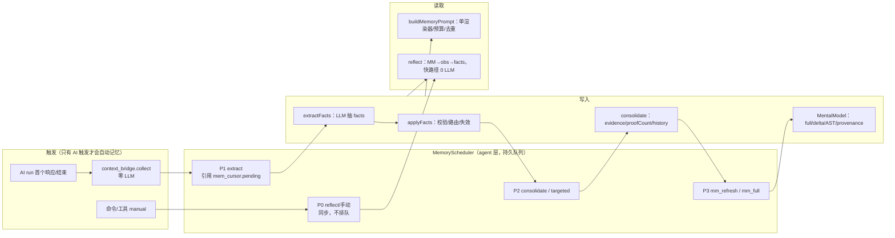

# 记忆模块最终实施方案（v3，唯一实现依据）

> **规范优先级**：本文件 > `04`（时机/默认值） > `03`（bank/可见性/命名） > `01`（数据模型/算法）。01/03/04 保留推导与证据；与本文冲突处以本文为准（见第 20 节冲突裁决）。
> 审查来源：`reviews/01-flow-review.md`、`reviews/02-redundancy-review.md`、`reviews/03-boundary-review.md`；本文已吸收其 P0/P1（第 20 节逐项）。
>
> **实现状态（2026-10-26）**：已落地 `MemoryService` + 可见性/标签 `access.ts` + v3 数据模型/迁移/引擎、`agent/memory_scheduler`、`context_bridge` 拆分、命令/工具/配置/注入接线、上下文解耦。验证：`tsc --noEmit` 0、`lint` 0、`test:unit` 632 通过（含 16 个 `testV3*`、context-bridge 拆分与调度器端到端）、`deps:check` OK（无新增跨层/动态 import）、`build`/`smoke` OK、`sim` 14/14、`sim:matrix` 76/0、`fuzz` 209211/0。实现以本文为准；旧 v2 行为测试已由 `testV3*` 取代，默认门禁跳过。

---

## 1. 目标、约束与非目标

### 1.1 目标

1. **三层 bank**：个人（user）/ 群聊（group）/ 全局本体（global）；三层独立抽取、巩固、注入。
2. **Hindsight 对齐的认知层**：原始事实 append-only；观察带 evidence/proofCount；心智模型带 `sourceQuery/content/trigger/tags/structuredContent/reflectResponse`；delta 类型化编辑 + 未命中段落逐字节不变。
3. **行为打通**：AI 触发 → 零 LLM 收集 pending → 后台抽取 → 自动巩固 → 可选 MM 刷新 → 下轮注入 / 按需 reflect；纠错走失效 + 定向巩固。
4. **不阻塞**：自动记忆 LLM 全部在回复之后/后台；用户命令/工具是唯一同步等待路径。
5. **不干烧 token**：无 AI 触发不自动抽取；空工作不调 LLM；队列合批/去重；预算/熔断；默认对齐 Hindsight（MM 自动刷新默认关）。
6. **上下文不耦合记忆**：`src/context/**` 不 import `memory/**`、不访问 `session.memory`。

### 1.2 硬约束

- goja 单进程、无 worker；`setTimeout` 可用；存储同步 KV、**无 key 枚举能力**。
- 分层：`memory` L2、`context/agent/session` L3、`core` L0；不新增跨层依赖/环（`deps:check` 当前 13 条既有违规，基线 332/1076 已滞后但 ratchet 只拦退化）。
- 不新增依赖；不做 PostgreSQL/worker/REST；每轮回复路径不新增记忆 LLM。

### 1.3 非目标

Hindsight 的 CARA opinion、disposition、webhook、bank 模板、PG/Oracle 后端、多租户 tag_groups；角色设定自动化改写；外部历史导入。

---

## 2. 行为架构

### 2.1 运行时总图



**关键点**：`A1/A2` 只发生在 AI 已触发的 run 内；没有 AI run 就没有自动 job。调度器 tick 只在队列非空且满足门控时工作。

### 2.2 模块依赖（最终，取消 memory_work 端口）

```text
L4  index.ts / cmd/ / tool/ / prompt/
          │
L3  agent/agent.ts ── agent/memory_scheduler.ts ── agent/context_bridge.ts
          │                     │ 向下                    │ 读 context/recall
          ▼                     ▼                         │
L2  memory/service.ts（唯一门面） ── memory/access.ts（纯函数）
          │
L2  memory/engine/*（engine/consolidation/mental_models/reflection/
          repository/storage/scoring/structured/llm/prompt/migrate_v3）
L1  memory/engine/{storage,repository,bank_resolver,templates,prompt}.ts
L0  core/*
L3  context/**  —— 不 import memory、不访问 .memory.；archiver 不再写记忆
```

- scheduler 放 **agent 层**：它需要 `Session`/`requestLimiter`/`getSessionById`；放 memory 会新增 L2→L3 跨层（虽然可用 L0 规避，但“调度属编排”更合理）。
- 取消原计划的 `core/ports/memory_work`：v2 下 `context/archiver` 的三处记忆调用已被 `context.ts:684,694` 短路；为近不可达的 legacy v1 新增端口 + 注册 + 测试桩不划算。**直接删除** archiver 的 3 处记忆调用（legacy 降级路径不再写记忆），`roster.findImage` 删掉最后一行的 `session.memory` 兜底（`Image.resolveRef` 已覆盖）。
- 静态守卫：`src/context/**` 禁止 import memory、禁止 `.memory.`；不影响 `prompt/memory_source`（读端口保持现状）。

### 2.3 三层 bank 与可见性（最终语义）

| 归属 | bankId | 写入 | 读取场景 | 默认可见性 |
|---|---|---|---|---|
| 个人 | `user_<sessionId>` | 私聊归档（owner）；群聊里关于该用户的稳定事实（origin:<gid>）；手动 | 本人 DM；来源群（origin）；显式 cross 时所有群 | DM 默认 `owner`；群来源默认 `origin:<gid>` |
| 群聊 | `group_<sessionId>` | 本群归档 | 本群 | `public`（本群） |
| 全局本体 | `global_<agentName>` | 手动（骰主）+ 可选 owner=bot 自动 | 该 agent 所有会话（小预算） | `public` |

**可见性三值**（标签 `vis:public | vis:origin:<scopeId> | vis:owner`）：

| 值 | user bank | group bank | global |
|---|---|---|---|
| `owner` | 仅本人 DM | 仅本群 | 仅所有会话（global 用 public） |
| `origin:<scope>` | 来源会话 + 本人 DM | 来源群 | — |
| `public` | 本人 DM + **所有**该用户发言的群（跨群，显式） | 仅本群 | 该 agent 所有会话 |

**默认/授权**：
- 私聊归档事实 → `owner`；群聊归档中关于用户的事实 → `origin:<gid>`；群 bank → `public`；全局 → `public`。
- 手动 `.ai memo add`：DM 默认 `owner`，群默认 `origin`；`--shared`（或工具 `visibility=public`）才跨群/全局可见。
- 私聊来源禁止 `owner=bot`；用户/群事实不自动晋升全局；全局自动抽取**默认关**。
- 保留前缀 `user:/group:/global:/vis:/src:/kw:` 由服务层注入；外部输入的 tag/keyword 命中保留前缀 → 拒绝。
- `memory_add` 的 `target_id` 必须是**当前会话可见**的用户/群（骰主命令例外）；否则拒绝。
- `createBank` 按 bankId 前缀强制 `kind`；不再有默认 `'global'`。

### 2.4 调度器状态机（最终）

```text
enqueue(key去重/合并)
  → queued ──门控通过──> running
       ↑                    │
       │  成功/skipped      ├──> done（消费下游，不保留）
       │  可重试失败        └──> backoff(1s→60s, attempts≤3)
       │                          │ attempts≥3 或连续失败3
       │                          ▼
       │                        dead ──熔断30min到期/reconcile──> queued
       │
       ├── 不可重试失败（JSON空/401/参数错）──> degraded（记录一次，不烧 token）
       ├── ctx purge/bank 删除/会话清空/配置关闭 ──> dropped
       └── 重载：running→queued, attempts+1；backoff/预算/熔断保留
队列 >200：丢 P3 → 合并 P2 → 仍超丢最旧非 P0；P0/每会话唯一 extract 不丢。
```

### 2.5 触发契约

| 触发 | job | source | 前置 | 成功副作用 |
|---|---|---|---|---|
| AI run 首个响应/结束 | extract | `ai` | 本会话 `aiTriggeredAt` 已置位；`mem_cursor.pending` 非空；非 headless/子代理 | facts；路由 bank；入队 consolidate |
| extract 完成 | consolidate（每 bank） | `ai` | bank 有 pending facts | 观察；touchedTags；可选 MM 队列 |
| 写 update/delete | consolidate_targeted | `ai`/`manual` | 有失效事实 | 观察改写 |
| consolidate 完成 | mm_refresh（仅启用时） | `ai` | 配置开 + tag 重叠 + stale + interval | content/AST/provenance |
| 模板播种 | mm_refresh(seed) | `seed` | 有来源、模板开启、pending | ready（一次） |
| delta 定期 | mm_full | `ai` | delta + 自动刷新开 + 48h + 新证据 | 先合成后替换 |
| tick | reconcile（只元数据） | — | 索引/meta 状态 | 入队，不直接 LLM |
| 用户 reflect/命令 | P0 直接执行 | `manual` | 参数有效 | 返回；不排队 |

---

## 3. 数据模型 v3

### 3.1 类型（`memory/engine/types.ts`）

```ts
export type BankKind = 'user' | 'group' | 'global';
export type FactType = 'world' | 'experience';
export type MemoryState = 'valid' | 'invalidated';
export type ConsolidationState = 'pending' | 'done';
export type Visibility = 'public' | 'origin' | 'owner';
export type TagsMatch = 'any' | 'all' | 'all_strict' | 'exact';

export interface MemoryUnit {
  id: string; bankId: string;
  text: string; factType: FactType;
  occurredStart?: number; occurredEnd?: number; mentionedAt?: number;
  createdAt: number; createdAtSeq: number; updatedAt: number;
  embedding: number[]; entityIds: string[];
  tags: string[];                         // scope/visibility/source/keyword
  metadata: Record<string, string>;
  importance: number; accessCount: number; lastAccessedAt: number;
  state: MemoryState;
  invalidatedAt?: number; invalidatedBy?: string; supersedes?: string;
  consolidationState: ConsolidationState; consolidatedAt?: number;
}

export interface Observation {
  id: string; bankId: string;
  text: string; tags: string[];
  evidence: Array<{ memoryId: string; quote: string; addedAt: number }>;
  proofCount: number;                     // distinct live sources，重算
  createdAt: number; updatedAt: number; lastSupportedAt: number;
  status: 'active' | 'invalidated';
  history: Array<{
    text: string;
    reason: 'created' | 'reinforced' | 'refined' | 'contradicted' | 'merged' | 'invalidated';
    at: number;
  }>;
  embedding?: number[];
}

export interface StructuredBlock { id: string; type: 'paragraph'|'bullet'|'checklist'|'code'; text: string; }
export interface StructuredSection { id: string; heading: string; blocks: StructuredBlock[]; }
export interface StructuredDoc { version: 1; sections: StructuredSection[]; }

export interface MentalModel {
  id: string; bankId: string;
  sourceQuery: string;
  content: string;
  structuredContent: StructuredDoc;
  trigger: {
    mode: 'full' | 'delta';
    refreshAfterConsolidation: boolean;   // 默认 false（Hindsight）
    factTypes: FactType[];
    tagsMatch: TagsMatch;                 // 有 tags 默认 all_strict
  };
  tags: string[];
  maxTokens: number;                      // 默认 2048
  status: 'ready' | 'pending' | 'failed';
  createdAt: number; updatedAt: number; lastRefreshedAt: number;
  lastFullRefreshAt: number;              // delta 定期 full 判定
  lastRefreshedSourceQuery: string;
  lastMemorySeenSeq: number;
  reflectResponse?: {
    at: number;
    basedOn: { mentalModelIds: string[]; observationIds: string[]; memoryIds: string[] };
    skipped?: 'empty_candidate' | 'llm_error' | 'no_memory' | 'source_query_changed';
  };
  history: Array<{ content: string; at: number; trigger: 'full'|'delta'|'manual'|'seed' }>;
  embedding?: number[]; templateId?: 'persona'|'preference'|'rules'|'self_rules'|'self_experience';
}

export interface MemoryBankMeta {
  id: string; kind: BankKind; agentName?: string;
  sessionId?: string;                     // 原始会话 ID（不带前缀）
  createdAt: number; updatedAt: number;
  schemaVersion: 3;
  settings: {
    seededMentalModelVersion?: number;
    nextFactSeq?: number;
    pendingFactCount?: number;            // tick 只读；不许扫描 units
    lastExtractAt?: number;
    lastConsolidateAt?: number;
    lastAutoRefreshAt?: number;
  };
}

export interface PersistedBank {
  meta: MemoryBankMeta;
  units: MemoryUnit[];
  entities: MemoryEntity[];
  links: MemoryLink[];
  observations: Observation[];
  mentalModels: MentalModel[];
}
```

**删除**：`MemoryDocument`/`MemoryChunk`/`documentId`/`includeChunks`/`chunks`、`MemoryUnit.context`、`ConsolidationState.failed`、`MemoryEntity.metadata/entityType`、未使用的 LinkType、`retainMission/observationsMission/disposition/directives/consolidateSince`、`Observation.scopeTags`（改 `tags`）、`ObservationHistoryEntry.status`（新鲜度改派生）、`MentalModel.question/answer/triggerConfig/scopeTags/lastMemorySeenAt`、`metadata.importance`。

### 3.2 存储布局（含索引与 meta 轻读）

| key | 内容 |
|---|---|
| `memv2:banks` | **字符串数组**：已存在的 bankId 索引（创建/首次读取时登记，删除时移除） |
| `memv2:<bankId>:meta` | `MemoryBankMeta`（含 pendingFactCount/last*） |
| `memv2:<bankId>:units` | units |
| `memv2:<bankId>:links` | links |
| `memv2:<bankId>:obs` | `{observations, entities, mentalModels}` |
| `mem_sched_v1` | scheduler 状态（第 10 节） |
| `mem_cursor:<sid>` | 上下文待抽取唯一事实源（pending 原文 + 游标） |
| `session_<id>` | `memory.observationEnabled` 等 |

- `MemoryStorage` 增加：`getBankMeta(id)`/`saveBankMeta(meta)`/`listBankIds()`；`saveBank` 支持 `parts` dirty 集合；删 `docs` 分片。
- 调度器 tick **只读** `memv2:banks` + meta；不 `getBank()` 解析 units/links/obs。
- `pendingFactCount` 在 retain 写入/consolidate 完成时原子更新（同一 save 写 meta）。
- `ctx purge` / `.ai memo clear`：清 `mem_cursor` + 丢弃相关 job（见 10.6）。

### 3.3 seq

- `nextFactSeq` 单调递增；unit `createdAtSeq=++nextFactSeq`；观察/模型水位用 seq，避免同秒漏记。

---

## 4. `MemoryService` / `MemoryAccess`

### 4.1 `MemoryService`（`memory/service.ts`，原 manager.ts 重命名）

| 方法 | 说明 | LLM |
|---|---|---|
| `retain(session, input)` | 服务层强制 scope/visibility tag；append/`contentHash` no-op（不改元数据）；embedding/links；更新 pendingFactCount | 否 |
| `extractFromChunk(session, chunk, source)` | 只做 LLM 抽 facts + `applyFacts`（校验/路由/写/失效）；**不 consolidate** | 1 次 |
| `consolidateBank(bankId, {maxFacts=50, targeted?})` | pending facts→观察；返回 touchedTags | 1 次/批 |
| `refreshMentalModel(bankId, modelId, {force, reason})` | 前置检查/单 pending/full|delta/空保护/provenance | 1 次 |
| `searchMentalModelsScored(bankId, query, opts)` | 返回 `{model, score, stale}`；注入/reflect 共用 | 否 |
| `reflect(bankId, query, opts)` | 三层；快路径 0 LLM；strict | 0/1 次 |
| `recall(bankId, query, opts)` | 四路 + RRF + 预算；无 LLM | 否 |
| `buildMemoryPrompt(ctx, session, text, uis, gi)` | 单渲染器/三 bank/预算/去重 | 否 |
| `invalidate(bankId, ids, reason)` / `clear` | 软失效/显式清 | 否 |
| `status(bankId)` | tier 计数、观察新鲜度、backlog、队列、下次刷新 | 否 |

### 4.2 `MemoryAccess`（`memory/access.ts`，纯函数）

`scopeTagsFor(bank|session)`、`visibilityTag(visibility, origin)`、`canRead(unit, viewer)`、`canMutate(unit, viewer)`、`selectInjectionCandidates`、`formatMemoryList`、`formatModel`、`parseIdOrIndex`、`resolveScope`。命令、工具、service、注入共用，**禁止**再写第二套权限/格式化。

---

## 5. 写入管线

### 5.1 context_bridge 拆分（唯一 pending 源）

```ts
collectContextBacklog(session): void;          // 只读事件→pending；0 LLM；AI 路径调用
peekExtractionChunk(session, maxChars=12000):  // 取一段；不足水位/null
  { text; throughSeq; textLength } | null;
commitExtraction(session, throughSeq, textLength): void; // 抽取成功后提交
```

- 删除 `consumeContextV2` 的 LLM 部分；`settleBacklog`（`agent.ts:119-130`）v2 分支只 `collectContextBacklog + compactContextV2`。
- `mem_cursor.pending` 是**唯一 pending 原文**；job payload 只存 `{sessionId, cursorEpoch}`，不存原文。
- `commitExtraction` 只由抽取成功调用；失败不 commit，job 退避；`epochStartSeq` 变化（purge）自动作废。
- 单段 ≤12k 字符；每 job 最多处理 2 段，仍有 pending 则续排。
- **没有 AI 触发**：不 collect、不 enqueue；standby 消息只进事件账本。

### 5.2 extract 算法

```ts
runExtract(job):
  session = getSessionById(job.sessionId)          // headless/子代理直接 skip
  if (!session || cursorEpoch changed) done()
  for (i<2) {
    chunk = peekExtractionChunk(session)
    if (!chunk) break
    outcome = memory.extractFromChunk(session, chunk, job.source)
    commitExtraction(session, chunk.throughSeq, chunk.textLength)
    for (bank of outcome.touchedBanks) enqueue consolidate(bank)
  }
  if (peekExtractionChunk(session)) enqueue(job)
```

`extractFromChunk`：
- 1 次 `summarize_agent`。**复用 `prompt/templates.ts` 现有 `SUMMARY_PROMPT_TEMPLATE` schema**（`op/existing_id/memory_type/target_id/type/text/occurred_at/entities/keywords/related_user_ids/related_group_ids/related_memory_ids/importance/visibility`），只做增量：`memory_type` 枚举扩展为 `private|group|global`（private=个人、group=群、global=本体）、`visibility` 枚举扩展为 `public|origin|owner`（原 private→owner）、增加 `confidence`、删除未使用的 `summary`。
- 解析后 `applyFacts`：
  - `memory_type=private` → 目标用户 bank（缺省当前用户）；群来源默认 `origin:<gid>`，DM 默认 `owner`；若 `EXTRACT_PERSONAL_FROM_GROUP=false`，群来源的 private 事实**改写当前 group bank**（origin），不写个人 bank。
  - `memory_type=group` → 当前群 bank；`public`。
  - `memory_type=global` → 全局 bank；默认关闭自动；关闭时**丢弃**（不兜底写当前 bank）；开启时校验无用户 ID/群 ID/联系方式、非私聊来源、confidence≥0.6、≤3 条/chunk。
  - `target_id`/`related_user_ids`/`related_group_ids` 只用于路由/标签；`existing_id` 校验同 bank/可见。
  - `op=add`：append；完全同文 contentHash → no-op；`update`：新 fact supersedes，旧 invalidated；`delete`：仅失效；`noop` 跳过。
  - `related_memory_ids` → related link。
  - 外部 tags/keywords 保留前缀拒绝；target 必须当前会话可见。
- **不调用 consolidate**；由 scheduler 负责。

---

## 6. 观察巩固

- 触发：extract 成功→每 touched bank enqueue；写 update/delete→30s 内 targeted；手动。
- 批量：单次 ≤50 facts（Hindsight `CONSOLIDATION_BATCH_SIZE=50`）；完成后续排；30s dispatch 合并同 bank job；同 bank 单飞（复用 engine `consolidatingBanks`）。
- 观察写入：evidence 去重（memoryId+quote）；`proofCount=distinct live sources` 重算；`lastSupportedAt=now`；history reason。
- 矛盾：旧 text 进 history，新 text 时间叙事；不覆盖、不物理删。
- 合并：0.97 阈值 + 保守规则（数字/实体/否定/条件不同不合并）。
- 过期：`observationFreshness` 派生：
  - `expired`：`lastSupportedAt` 超 90 天（用于注入跳过/status），**不删除**；
  - `backlog`：未巩固 pending facts 0 / <10 / ≥10 → `up_to_date/slightly_stale/stale`（用于 reflect 信任/status）。
  两个信号正交，命名分开。
- `obs clr --yes`：清 observations + 源事实 `consolidationState=pending`；链接/evidence 级联清理。
- 失败：retry 1s/2s/4s…上限 60s，最多 3 次；空/JSON 失败 degraded 不重试；连续 3 job 失败熔断 30min。
- 完成更新 `meta.pendingFactCount/lastConsolidateAt`；返回 touchedTags。

---

## 7. 心智模型

### 7.1 默认（Hindsight 对齐，注意是**行为变更**）

| 项 | 新默认 | 迁移 |
|---|---|---|
| `mode` | full | 保留旧值 |
| `refreshAfterConsolidation` | **false** | 旧默认 true → 统一 false（避免升级后自动烧 token） |
| `minRefreshInterval` | **0** | 旧 30min；新默认 0；UI 提示开启自动刷新时建议 ≥30 |
| `failedCooldown` | **30min**（独立配置，不再复用最小间隔） | 新增 |
| `maxTokens` | **2048** | 旧实参 4096 → 2048 |
| delta 定期 full | **48h** | 新增 `lastFullRefreshAt` |

### 7.2 创建/模板

- 手动 create：无 content → pending + 立即 enqueue `mm_refresh(full, source='manual')`；有 content → ready。
- 固定模板（persona/preference/rules/self_rules/self_experience）：
  - 有来源才播种；播种后**立即 enqueue 一次 `mm_refresh(full, source='seed')`**（每模板一次，不受 `refreshAfterConsolidation` 限制）→ 解决“pending 永不 ready”。
  - 迁移后遗留 pending 模板：reconcile 在首次 AI 活动时补一次 seed job。
  - 模板删除不会自动复活（版本门保留）。

### 7.3 刷新

```ts
refreshMentalModel(bankId, id, {force, reason}):
  model = ...
  if (single pending per (bank,model)) coalesce marker  // 不丢弃，完成后再判
  if (!force) {
    if (failed && now-lastFailedAt < failedCooldown) skip('failed_cooldown')
    newSeq = maxInScopeSeq()
    if (newSeq <= lastMemorySeenSeq) skip('not_stale')
    if (lastRefreshedAt + minInterval > now) skip('interval')
  }
  mode = (trigger.mode==='delta' && baseline && sourceQuery===lastRefreshedSourceQuery && !forceFull) ? 'delta' : 'full'
  if delta: recall(createdAfterSeq=lastMemorySeenSeq) → LLM typed ops → applyDeltaOps
  else: reflect.strict(fastPath=false) → content
  if empty: keep old content; reflectResponse.skipped; no watermark/status=failed for empty? -> skipped('empty_candidate'), status unchanged
  else: history.push(old); content/structured; version++; status ready; lastRefreshedAt; lastMemorySeenSeq=newSeq;
        lastRefreshedSourceQuery; reflectResponse={basedOn}; save
```

- 类型化操作：`add_section/append_bullet/replace_block/remove_stale_paragraph/replace_section_blocks`；blockId 校验；未命中 block 逐字节复制（测试 hash）。
- 回退 full：无 baseline/sourceQuery 变化/解析失败/空输出。
- 定期 full：`mode=delta && refreshAfterConsolidation && now-lastFullRefreshAt>=48h` → full；先合成后替换。
- 自动刷新触发：consolidate 返回 touchedTags；仅 `refreshAfterConsolidation && (tags empty || intersect(tags,touchedTags))`；同一模型单 pending；每 model 最小间隔。
- 失败：保留旧 content/水位；failed + lastFailedAt；冷却后由 reconcile 重试。
- 读取：`searchMentalModelsScored` 返回 score/stale；注入/reflect 共用；`isStale = maxInScopeSeq > lastMemorySeenSeq`。

---

## 8. Reflect

1. `searchMentalModelsScored` top3；fresh && score≥阈值 && `fastPath` → 直接返回 content（0 LLM），basedOn。
2. 否则 `searchObservations`（backlog 分级）+ `recall` facts；无证据 → 空/“无记忆”，不调 LLM。
3. 有证据 → 1 次 LLM 合成；prompt 引用证据 id；stale 时以 facts 为准。
4. 返回 basedOn；用户 reflect 不写回；MM 刷新才写 `reflectResponse`。
5. 可选同 query 60s 缓存（同 bank）。

---

## 9. 注入与渲染（单入口）

1. `sessionTags` = 本会话 scope + 最近发言者 + 全局 agent tag；`canRead` 过滤。
2. 读当前 bank、最近发言者个人 bank、global bank；MM/obs/facts。
3. 选择：MM 固定模板优先 + 语义 scored；obs active + scope（backlog 不隐藏，expired 排除）；facts recall(collapseObservations)。
4. 预算：总 3000 tokens；**优先当前会话**，其次发言者个人，最后 global（global 上限 300）；超预算按分数截断。
5. 去重：归一化文本 hash；同一观察一次；跨 bank 同文一次。
6. 分组：群聊/个人/本体；归属行；私聊单段。
7. `observationEnabled = session.override ?? config`；`vis:owner/origin` 在群里不可见；private DM 不进群。
8. 删除 `buildObservationPrompt` 双入口；`prompt/builder.ts` 两段 cache 合并为一个记忆 cache。

---

## 10. 调度器（`src/agent/memory_scheduler.ts`）

### 10.1 状态

```ts
interface MemoryJob {
  id; kind: 'extract'|'consolidate'|'consolidate_targeted'|'mm_refresh'|'mm_full';
  bankId; sessionId?; modelId?;
  source: 'ai'|'archive'|'manual'|'seed';
  priority: 0|1|2|3;
  notBefore; attempts;
  payload: { cursorEpoch?: number; throughSeq?: number; scopeTags?: string[] };
}
interface SchedulerState {
  version: 1;
  jobs: MemoryJob[];
  running: string | null;         // 重载时清空
  lastTickAt;
  lastAiActivityAt;               // 本进程；启动 0
  hourly: { windowStart; llmCalls };
  failureStreak; pausedUntil;
}
```

- 持久 `mem_sched_v1`；写穿；队列空停 tick；`enqueue` 唤醒 `ensureRunning`。
- 测试注入口：`tick(now)`、`now()`、`setTimer/clearTimer`；不依赖真实等待。
- 队列上限 200；P1 每会话唯一 extract；同 key 合并。

### 10.2 tick 门控

```ts
tick(now):
  if (pausedUntil > now) return
  if (hourly cap exhausted && job.priority>0) return
  if (lastAiActivityAt === 0 && job.source !== 'manual') return   // 本进程无 AI（seed 也一样等首次 AI）
  if ((job.source === 'ai' || job.source === 'seed') && now - lastAiActivityAt > 30min) return // 等下一次 AI
  if (job.priority > 0) {
    const q = requestLimiter.getQueueInfo()
    if (q.active > 0 || q.queued > 0) { defer 5s; if waited>10min run; return }
  }
  run(job)
```

- **不调用 `requestLimiter.acquire`**（FIFO 会让后台插到用户前）；只探测 active/queued。
- `lastAiActivityAt`：`onRunEnd` 设置；只有 `acquired && !session.headless && session.subagentDepth===0` 才设。
- 无 AI 门：新进程启动后自动 job 等首次 AI；手动/命令不受限。30min grace 解决“AI 后转待机就永远不跑”；超窗等下一次 AI。
- 预算：每次 LLM 前计数；20/小时；P0 不受限。
- 熔断：连续 3 次失败 30min；`degraded` 不重试。

### 10.3 失败/恢复

- `running`→重启视为 queued、attempts+1；不重复写事实（contentHash/consolidationState）。
- 成功 consolidate 后若 `pendingFactCount>0` 仍保持 queued（防止新事实漏巩固）。
- bank 不存在 → skipped+删除 job；`ctx purge`/`memo clear` → dropped；`cursorEpoch` 不匹配 → dropped。
- 存储写失败：不推进水位、不 commit；重试。
- 空工作（无 pending/no source/不 stale）→ skipped，不消耗 LLM，不发 attempts。

### 10.4 接线

| 位置 | 动作 |
|---|---|
| `agent.run` / `runStream` 首个成功响应前 | `session.aiTriggeredAt=now`（运行时字段） |
| `agent.run` / `runStream` `finally`（189-203/500-514） | `MemoryScheduler.onRunEnd(session)`；guard acquired/headless/subagent；只 enqueue |
| `agent.settleBacklog`（119-130） | v2：`collectContextBacklog + compactContextV2`；legacy：`settleWindowIfNeeded`（不再写记忆） |
| `index.ts`（TimerManager.init 同区） | `MemoryScheduler.init()` |
| 命令/工具 | `MemoryService` 直接调用，P0 不排队 |
| tick | reconcile：索引/meta、重试、模板 seed、定期 full、丢失 job |

### 10.5 可观测

`.ai memo status`：pending 抽取/巩固、backlog 分级、观察过期数、队列、本小时 LLM、熔断、下次刷新、MM 自动刷新开关、模板 seed 状态。
`.ai memo ops`（骰主）：最近 20 条 job。

### 10.6 purge/clear

- `ctx purge`：删除该会话 job；`mem_cursor` epoch 变化自动作废。
- `.ai memo clear`：清 bank 事实/观察/命中模型？默认清原始事实与观察；删除该 bank 的 consolidate/extract job；`mem_cursor` 中 pending 不删（避免影响上下文），但 commit 时 bank 已空仍可写；用户明确“忘记”应同时清 cursor（命令 `--all`）。
- 隐私：job payload 不含原文；pending 原文只在 mem_cursor，可随 purge 清。

---

## 11. 上下文解耦（最终：删除而非端口）

| 位置 | 动作 |
|---|---|
| `context/archiver.ts:6` | 删除 `import MemoryManager` |
| `context/archiver.ts:95,377,414` | 删除 3 处 `summarizeChunkWithRetry`；保留归档分片/窗口逻辑。legacy v1 降级路径**不再写记忆**（日志一次） |
| `context/roster.ts:98` | 删除 `return host.session.memory.findImage(id)`，返回 `null`（`Image.resolveRef` 已覆盖图片解析） |
| `context/**` | 静态守卫：禁止 import memory、禁止 `.memory.` |
| `prompt/memory_source.ts` | 保留（读端口）；不新增写端口 |
| `index.ts` | 不注册 memory port；只 init scheduler |

- 不在 v2 路径新增 context 分支；legacy v1 的“归档写记忆”作为已知功能缩减记录文档（v1 仅迁移/回退）。
- 顺带记录：`context_too_long` 在 v2 下使用 `archiveByTokenIfNeeded` 返回 `'converged'` 被当成功（`agent.ts:416` + `context.ts:694`）是**非记忆**的既有缺陷，另立工单，不混入本方案。

---

## 12. 命令与工具

### 12.1 命令

- `status`：tier 计数、backlog、过期、队列、预算、下次刷新、自动刷新开关、模板 seed。
- `add/update/delete/list/clear`：单服务；`#N`；默认可见性按 scope；`--shared` 跨群；`clear --yes`。
- `obs list|view|clr --yes|on|off|refresh`：refresh 同步执行；clr 重置 pending；on/off 真正 gate。
- `consolidate`：同步；中文原因。
- `reflect <问题>`：快路径；`--deep`。
- `mm list|view|add|refresh|clear|del`：显示 stale/自动刷新/下次；`clear` 清 content 强制 full。
- 范围：`--u`/`--g`/`--self`；跨 ID 仅骰主；全局写/清仅骰主。

### 12.2 工具 12→7

`memory_recall / memory_add / memory_update / memory_delete / memory_consolidate / memory_reflect / memory_mental_model`（action 枚举替代 5 个 mm 工具）。删 `memory_clear`（命令 + --yes）。
参数：`memory_scope: user|group|global`、`visibility`、`fact_kind`；`target_id` 默认当前会话且必须可见；工具全部走 `MemoryService` + `MemoryAccess`。

---

## 13. 配置最终表（面板只在这里）

| 面板名 | 内部 key | 类型 | 默认 | 备注 |
|---|---|---|---:|---|
| 启用长期记忆 | `MEMORY_ENABLED` | bool | true | 同时 gate 写入/注入 |
| 启用观察记忆 | `OBSERVATION_ENABLED` | bool | true | gate consolidate/注入 |
| 自动记忆抽取 | `EXTRACT_ENABLED` | bool | true | AI 触发后自动；关=手动 |
| 群聊→个人抽取 | `EXTRACT_PERSONAL_FROM_GROUP` | bool | **false** | 隐私未收口前默认关 |
| 本体自动抽取 | `EXTRACT_GLOBAL` | bool | **false** | 全局污染风险；骰主可开 |
| 启用全局记忆 | `GLOBAL_MEMORY_ENABLED` | bool | true | 注入/手动；无数据零成本 |
| 长期记忆条数上限 | `MEMORY_MAX_FACTS` | int | 300 | 安全阀 |
| 召回新近度权重/半衰期 | `RECALL_RECENCY_WEIGHT/HALF_LIFE_DAYS` | float/int | 0.4/60 | 保留 |
| 语义相似度下限 | `RECALL_SEMANTIC_MIN_SIM` | float | 0.35 | 新增 |
| 巩固批量 | `CONSOLIDATION_BATCH_SIZE` | int | **50** | Hindsight |
| 巩固派发窗口 | `CONSOLIDATION_DISPATCH_SEC` | int | 30 | 合批 |
| 后台并发/小时上限 | `BACKGROUND_CONCURRENCY/HOURLY_LLM_CAP` | int | 1/20 | 安全阀 |
| 失败重试/熔断 | `BACKGROUND_MAX_ATTEMPTS/BREAKER_MIN` | int | 3/30 | 退避常量 1s→60s |
| 自动维护固定心智模型 | `MM_TEMPLATES` | bool | true | 播种 + seed refresh |
| 刷新模式 | `MM_DEFAULT_MODE` | full/delta | **full** | Hindsight |
| 巩固后自动刷新 | `MM_REFRESH_AFTER_CONSOLIDATION` | bool | **false** | per-model 可覆盖；全局开关保留 |
| MM 最小间隔 | `MM_MIN_REFRESH_INTERVAL_MIN` | int | **0** | per-model；建议开启自动刷新时 ≥30 |
| MM 失败冷却 | `MM_FAILED_COOLDOWN_MIN` | int | 30 | 独立 |
| MM 输出上限 | `MM_MAX_TOKENS` | int | **2048** | 修正 4096 |
| delta 定期 full | `MM_DELTA_FULL_REBUILD_HOURS` | int | **48** | 需 `lastFullRefreshAt` |
| 注入总预算/全局段 | `INJECT_MAX_TOKENS/INJECT_GLOBAL_MAX_TOKENS` | int | 3000/300 | 单入口 |
| LLM 重排/观察合成/推理 | `LLM_RERANK/LLM_OBS_SYNTH/LLM_REFLECT_SYNTH` | bool | false/true/true | 保留 |

**删除**：`MEMORY_MM_TICK_INTERVAL`、`MEMORY_REFRESH_AFTER_CONSOLIDATE`（旧全局，改 per-model）、`MEMORY_LLM_EXTRACT`、`MEMORY_CAP`（改名）、`summaryStatus/summaryOverride` 双字段（→ observationEnabled）、`consolidateSince`、抽取静默窗口/巩固阈值/巩固最小间隔（合并成 dispatch/批量）。
**生效**：新增 `config/apply/memory.ts` 更新 engine 回调/caps/recency、暂停/恢复 scheduler；不要求重载。

---

## 14. 迁移 v2→v3（设施全新建）

1. **新增** `schemaVersion` 字段；`repository.getBank` 缺失视为 2；迁移入口 `memory/engine/migrate_v3.ts`（旧 `v2/migrate.ts` 是 legacy 导入器，仅测试使用 → 删除，测试同步）。
2. 顺序：读 4 分片 → 内存转换 → 写 units/links/obs（全部成功）→ **最后写 meta(schemaVersion=3)**；任一步失败保留旧 meta，下次重试。
3. 备份：首次迁移**按分片**写 `memv2:<bank>:backup_v2:<ts>:<units|links|obs|meta>`（避免单 key 过大）；1 个版本后清理；失败可手工恢复。
4. facts：仅 world/experience；按 createdAt 分配 seq；删 context；**可见性重分类**：
   - user bank：旧 `public/private` 一律 → `owner`（仅 DM，防存量泄漏；用户可改 shared）；
   - group bank：`public` 保留，`private:<sid>` → `origin:<gid>`；
   - 旧 `vis:private:<x>` → `origin:<x>`（group）/`owner`（user）。
5. observations：`scopeTags→tags`；`lastVerifiedAt→lastSupportedAt`；status 只存 active/invalidated；过期改为派生；history reason 归一。
6. mentalModels：`sourceQuery=question`、`content=answer`、`structuredContent=parseMarkdown(answer)`、`trigger={mode:old||'full', refreshAfterConsolidation:false（旧默认 true 统一降级，避免升级后自动烧 token）, factTypes, tagsMatch:tags.length?'all_strict':'any'}`、`maxTokens=2048`、`lastRefreshedSourceQuery=sourceQuery`、`lastMemorySeenSeq=0`、`lastFullRefreshAt=lastRefreshedAt`、`reflectResponse` 缺失、history 迁移；旧 pending 模板由 reconcile 补 seed。
7. `factType='observation'` 删除：14 处引用（types/engine/consolidation/reflection/scoring/mental_models/session_memory/manager/migrate/cmd + prompt 文本）一并改；同步删除 unit 与 evidence/links 级联。
8. documents/chunks：删 `docs` 分片；无调用方。
9. session state：`summaryStatus/summaryOverride→observationEnabled`；`migrateLegacyPersona` 用 sourceQuery。
10. `global__`→`global_main`（若存在），保留别名读一次。
11. `mem_sched_v1` 新 key；旧无；`running` 启动清空。`ctx purge`/`memo clear` 清 cursor/job。
12. 迁移样本 fixture（v2 bank）与新测试；5 个 harness 文件（sim/sim-matrix/fuzz/2 unit）同步改造：不再猴补 `MemoryManager.summarizeChunkWithRetry`，改为注入 `MemoryService.extractFromChunk`/scheduler stub。
13. 回滚：备份恢复 4 分片；删除 `mem_sched_v1`；**不接受双读**（按 05 决策）。
14. 旧 `v2/migrate.ts`（legacy memoryMap 导入器，仅测试使用）删除；新迁移在 `migrate_v3.ts`；相关测试迁移。
15. 文档同步：`docs/03-核心模块详解.md` 记忆章（202/209/214）、`docs/05-命令与配置.md:139` 死配置、`README.md` 配置表 480-494/模板 555/工具表 738、`SUMMARY_TEMPLATE` 与“6 个模板”描述、changelog；删除 `SUMMARY_TEMPLATE` 与旧 `buildObservationPrompt` 文档。

---

## 15. 文件清单与预算（诚实版）

| 文件 | 动作 | 估计 |
|---|---|---|
| `memory/service.ts`（原 manager） | 重命名/收口 | ~300 |
| `memory/session_state.ts` | 原 session_memory，仅字段 | ~80 |
| `memory/access.ts` | 新纯函数 | +120 |
| `memory/engine/types.ts` | 新类型 | ~250 |
| `memory/engine/engine.ts` | retain/recall | ~450 |
| `memory/engine/repository.ts` | 去 docs/meta 轻读/index | ~330 |
| `memory/engine/storage.ts` | 分片/meta/index/backup | ~130 |
| `memory/engine/consolidation.ts` | 观察语义 | ~230 |
| `memory/engine/mental_models.ts` | AST/delta/refresh | ~450 |
| `memory/engine/reflection.ts` | 三层/快路径 | ~180 |
| `memory/engine/structured.ts` | AST | +90 |
| `memory/engine/prompt.ts` | 单渲染器 | ~160 |
| `memory/engine/scoring.ts` | tags/阈值/seq | ~150 |
| `memory/engine/llm.ts` | 提示词/schema | ~200 |
| `memory/engine/migrate_v3.ts` | 新迁移 | +180 |
| `memory/engine/bank_resolver/templates/index` | 小改 | ~120 |
| `agent/memory_scheduler.ts` | 新（持久队列/门控/状态机） | +180 |
| `agent/context_bridge.ts` | split collect/peek/commit | ~200 |
| `context/archiver.ts` | 删 3 处 memory 调用 | ~485（−5） |
| `context/roster.ts` | 删 memory 行 | ~119（−1） |
| `config/apply/memory.ts` | 配置生效 | +50 |
| `tool/tools/memory/tool_memory.ts` | 12→7 | ~500 |
| `cmd/sub_cmd/memory.ts` | 命令收口 | ~600 |
| `index.ts` | scheduler init | +10 |
| 测试 | 续写现有 entry/context-bridge + scheduler 用例 | +250~350 改/增 |

**结论**：生产代码约 **4830 → 4850–5000（基本持平/略增）**；不承诺“净减 350”。收益是删除 4 条重复路径（observation unit、string-only delta、one-shot reflect、context→memory 直连）与单一事实源；预算已计入 scheduler/access/migration/context/test 改造。

**命名/目录**：`memory/v2/` 重命名为 `memory/engine/`（去掉 v2 历史包袱），`manager.ts→service.ts`、`session_memory.ts→session_state.ts`；全量更新 import/文档。`memory/access.ts` 纯函数；不新增 `service.ts` 与 `ports/memory_work`。

---

## 16. 阶段

| 阶段 | 内容 | 前置 |
|---|---|---|
| **P0 隐私/止血** | 可见性三值 + 写入 scope tag + 保留前缀 + target 授权 + 存量 visible 重分类；`clear --yes`；删 archiver memory 调用/roster；修 `memory_update` 越权；MM 默认值迁移/模板 seed；调度器骨架（无 LLM） | — |
| **P1 数据/观察/调度** | v3 types/repository/storage/index/migrate；去 observation unit；单渲染器；MemoryService/Access；context_bridge split；extract/consolidate job；token 门 | P0 |
| **P2 心智模型** | structured/AST/full/delta/provenance；seed/refresh queue；48h full；默认对齐 | P1 |
| **P3 reflect/全局/命令** | 三层 reflect/快路径；global bank/--self/注入；命令/工具 7；status/ops | P2 |
| **P4 收口** | 删除旧路径/文档/README/docs/SUMMARY_TEMPLATE；测试全绿；手工 QQ | P3 |

---

## 17. 测试

- **引擎**（续写 `scripts/unit-test-entry.ts`）：append/duplicate no-op/seq；recall tagsMatch/阈值/去重/预算；观察 evidence/proof/矛盾/过期派生/obs clr；MM AST/full/delta/回退/空保护/单 pending/48h；reflect 快路径。
- **调度**（同 entry 或独立 scheduler 用例）：假时钟 `tick(now)`；无 AI 不跑；AI 30min 窗口；让路探测（active>0 不取）；预算/熔断/重启 dirty running；队列合批；模板 seed；purge/clear dropped。
- **上下文**：`unit-test-context-bridge.ts` 改为注入新 split 方法；legacy archiver 不再写 memory；静态守卫（context 无 memory import/.memory.）。
- **迁移**：v2 fixture → v3；备份/失败重试/可见性重分类；`factType=observation` 清零。
- **命令/工具**：12→7、`--yes`、`#N`、scope/target 权限、中文原因。
- **仿真/手工**：sim/sim-matrix/fuzz 更新 5 处猴补；QQ 群连续聊天/纠正/待机/重载/失败/清除。
- **质量门**：tsc/lint/test:unit/deps:check/package:check；deps 不新增。

---

## 18. 验收

1. 写入→注入契约：命令/工具/归档/媒体默认写入后，同会话注入可见；可见性矩阵符合。
2. 私聊 `owner` 不进群；群来源 `origin` 不进其他群；`public` 才跨群；全局默认关。
3. 无 AI 触发的会话 100 条消息 → 记忆 LLM 0；空队列 tick 不调 LLM。
4. 模板 seed：首次有来源后模板从 pending 变 ready（一次），之后默认不自动刷新（0 次）。
5. delta 未命中 block hash 不变；空输出保留旧 content；48h full 先合成后替换。
6. 重载不丢 pending/不重复 proof；purge/clear 清 job/cursor；熔断恢复。
7. `src/context/**` 无 memory import/.memory.；deps 无新增。
8. 生产代码无死配置/参数；status 可解释“为什么不抽取/不刷新”。

---

## 19. 风险与回滚

| 风险 | 对策 |
|---|---|
| 默认值变更（MM true→false、maxTokens 4096→2048、可见性） | changelog + 迁移 + status 明示；不双读 |
| 迁移中途失败 | 先写数据分片后写 meta；备份；重试；回滚脚本 |
| delta LLM ops 不稳 | schema/blockId 校验 + 回退 full + hash 断言 |
| 后台抢模型 | 不 acquire；active/queued 探测；5s 让路；10min 上限；预算 |
| 全局/群→个人自动抽取污染 | 默认关；开时过滤 + master 配置；可见性 |
| legacy v1 不再写记忆 | 文档标注；v2 为当前路径；如必须保留，另立工单注入回调（不新增端口） |
| `context_too_long` v2 空转 | 非记忆缺陷，另立工单（agent.ts:416 + context.ts:694） |

---

## 20. 审查裁决与整改

### 20.1 Flow review（01）

| 问题 | 裁决/整改 |
|---|---|
| B1 模板 pending 永不 ready | 模板播种立即 enqueue `mm_refresh(full, source='seed')`（每模板一次）；迁移遗留 pending 由 reconcile 补 seed（§7.2） |
| B2 抽取/观察挡在回复前 | `consumeContextV2` 拆 collect/peek/commit；`settleBacklog` 只 collect；extract/consolidate 由 scheduler 回复后/后台执行；`summarizeChunk` 内不再 consolidate（§5） |
| B3 无调度/恢复 | 新增 scheduler + `mem_sched_v1` + index/meta；启动 init；状态机/重载（§10） |
| B4 MM 默认三方互斥 | 05 唯一：full、refreshAfter=false、min=0、maxTokens=2048、失败冷却 30min；01/03/04 修改引用（§7、§13） |
| B5 标签契约 | 服务层强制 scope/visibility；tests（§2.3、§5） |
| B6 全局 0 入口 | global bank/命令/注入/工具（§2.3、§4、§12） |
| B7 跨 bank 路由 | `applyFacts` owner 路由（§5.2） |
| B8 reflect 无快路径/两套 selector | `searchMentalModelsScored` + `MemoryAccess.selectInjectionCandidates` 共用（§4/§8） |
| B9 观察双份/物理删/开关 | 删 unit/双入口；expired 派生不删；`observationEnabled` 接 builder（§6/§9） |
| B10 失败/熔断/重载 | 状态机/退避/熔断/dirty running（§10.3） |
| B11 archiver 死路径/端口收益 0 | **删除** archiver 3 处 memory 调用 + roster 行，不新增端口；`context_too_long` 另立工单（§11、§19） |
| D1/D3/D6/D7 | 05 统一：默认值/派生 stale/预算/可见性（§7、§6、§15、§2.3） |
| D2/D4/D5/D8/D9 | 触发表（§2.5）、预算优先级（§9）、AI 30min grace（§10.2）、单渲染器（§9）、`global_main` 迁移（§14） |
| 存储无枚举/tick 非只读 | `memv2:banks` 索引 + meta pendingFactCount + `getBankMeta`（§3.2、§10） |
| touchedTags/score API 缺失 | 新增参数/返回（§4、§7） |
| 现有 bridge 测试存在（非 0 测试） | 00 报告更正；测试续写现有 entry/context-bridge，不新建重复文件（§17） |

### 20.2 Redundancy review（02）

| 问题 | 裁决 |
|---|---|
| 01/03/04 六类重复 | 05 唯一规范；01/03/04 顶部加“以 05 为准”；删除默认值/触发重复表 |
| 观察双份/双注入 | 删 `syncObservationUnit/factType=observation/preferObservations/SessionMemoryService.buildObservationPrompt`；builder 两 cache 合一 |
| 抽取双实现/四入口 | `extractFacts`(LLM) + `applyFacts`(路由/写) 唯一；`consumeContextV2` 唯一自动入口；archiver/cmd 调同一服务 |
| 三个门面/命名撞车 | `MemoryService`（原 manager）+ `SessionMemoryState` + `access.ts`（纯函数）；不新增 service.ts |
| 死字段/死配置 | 全部列入 §3.1/§13 删除；包括 consolidateSince/configureDefaultCallbacks/docs/chunks 等 |
| 可见性两套 | 05 §2.3 唯一；01 的 vis:private 删除；迁移一次 |
| 命令/工具双份 | `MemoryAccess` 统一权限/格式化；12→7；删 memory_clear；修 update 反向 |
| 预算不实 | §15 诚实版；取消净减 350；计入 scheduler/access/migration/context/test |
| context 端口 | 删除 archiver 调用，不建 memory_work；不合并 memory_source（保留读端口） |
| SUMMARY_TEMPLATE/tests/docs 遗漏 | §14/§17 + 文档同步清单（§15 邻接） |

### 20.3 Boundary review（03）

| 问题 | 裁决 |
|---|---|
| 布尔端口丢数据 | 取消端口；v2 不再有“入队即成功”；commit 只在抽取成功后；archiver 删调用 |
| L1 阻塞 | 拆 collect/extract；后台；`requestLimiter` 不 acquire；探测 active/queued；tick(now) |
| 私聊进群（S0） | 默认 `owner`；群来源 `origin`；`public` 显式；迁移旧 user bank→owner；全局/群→个人自动抽取默认关 |
| 全局污染 | 默认关；开启时 owner=bot 过滤 + 无 ID + confidence；master 控制 |
| 前缀伪造/越权/kind | 保留前缀拒绝；target 可见性；createBank 按前缀强制 kind |
| 双源/膨胀/tick 读全库 | pending 唯一 mem_cursor；job 只存引用；index+meta pendingFactCount |
| 让路反了 | 探测式让路（active/queued===0），不 acquire；5s/10min |
| finally/headless/standby | `aiTriggeredAt` 在首个响应前；finally guard acquired/headless/subagent；30min grace；待机不立即暂停已有 job |
| 迁移不可回滚/设施缺失 | 新建设施；原子序；备份；14 处引用清单；5 harness 改造；无 schemaVersion 属新建 |
| 默认值/行号硬伤 | §7/§13 修正；文档引用已更新 |
| archiver 端口收益 0 | 删除调用（§11） |

---

## 21. 明确不做（防冗余）

- 第二套 scheduler / 第二个 MemoryService / 第二套渲染 / 第二套权限。
- observation unit、旧 delta 软重写、旧 one-shot reflect、`preferObservations` hack。
- documents/chunks、disposition/directives、opinion 网络。
- context import memory / `.memory.` 访问。
- 常驻空转定时器；后台任务做成 `.ai timer` 类型。
- 无 AI 活动的自动抽取/刷新默认行为。
- 为 legacy v1 新建 memory 写端口（直接删调用，文档记录降级）。
